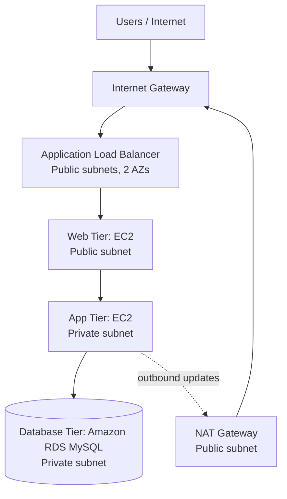

# Three-Tier Web Application on AWS

A three-tier web application built manually in the **AWS Management Console** (AWS Academy lab, us-east-1).
The web, application and database tiers each sit in their own subnets, and security groups only allow traffic from the tier in front.

## Architecture

## AWS services used

| Service | Purpose |
|---|---|
| Amazon VPC | Isolated network (10.0.0.0/16) |
| Subnets | 2 public (web), 2 private (app), 2 private (database) across 2 Availability Zones |
| Internet Gateway | Internet access for the public subnets |
| NAT Gateway | Outbound internet for private subnets (updates, packages) without exposing them |
| Route Tables | Public-RT (route to IGW), Private-RT (route to NAT) |
| Application Load Balancer | Single public entry point, health checks on the web tier |
| Amazon EC2 | Web tier and application tier servers (Amazon Linux) |
| Amazon RDS (MySQL) | Managed database in private subnets, not publicly accessible |
| Security Groups | Tier-to-tier access only (see below) |

## Security group rules

| Security group | Allows inbound from |
|---|---|
| ALB SG | HTTP (80) from the internet |
| Web EC2 SG | HTTP (80) from ALB SG only |
| App EC2 SG | App port from Web EC2 SG only |
| Database SG | MySQL (3306) from App EC2 SG only |

## Steps followed (AWS Console)

1. Created the VPC (`Research-VPC`, 10.0.0.0/16).
2. Created 6 subnets across 2 AZs: `Public-Subnet-1/2`, `App-Subnet-1/2`, `DB-Subnet-1/2`.
3. Created and attached the Internet Gateway (`Research-IGW`).
4. Created `Public-RT` with a 0.0.0.0/0 route to the IGW and associated the public subnets.
5. Created a NAT Gateway in `Public-Subnet-1`.
6. Created `Private-RT` with a 0.0.0.0/0 route to the NAT Gateway and associated the app and DB subnets.
7. Created the security groups listed above.
8. Launched the web and app EC2 instances in their subnets.
9. Created a target group and an Application Load Balancer across both public subnets.
10. Created a DB subnet group and an RDS MySQL instance with public access turned off.
11. Tested the site through the ALB DNS name.

## Clean-up (to avoid charges)

Deleted in this order: RDS instance, ALB and target group, EC2 instances, NAT Gateway, Elastic IP, route tables, subnets, Internet Gateway, VPC.

## Screenshots

See the `screenshots/` folder.

## What I learned

- How public and private subnets differ, and why only the load balancer faces the internet
- How a NAT Gateway gives private servers outbound access
- How chaining security groups limits each tier to the tier in front of it
- Why NAT Gateways and RDS should be deleted after testing to control cost

## Next steps

- Rebuild this setup with Terraform (in progress in `terraform-learning/`)
- Add an Auto Scaling group for the web tier

## Author

Bokkasam Kavya Sree
